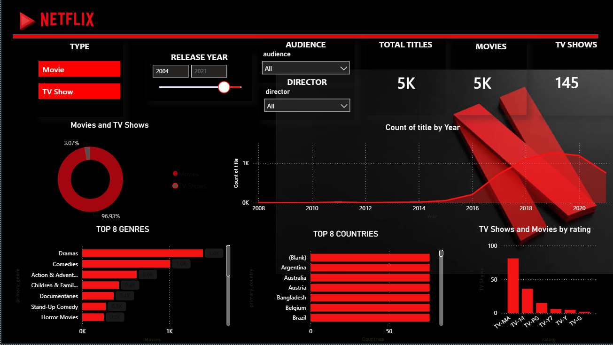

   

Typing SVG

Show Image Show Image Show Image Show Image Show Image Show Image

🚀 Quick Start  •  📊 Insights  •  🧩 Features  •  🗂️ Dataset  •  👤 Author

🖥️ Dashboard Preview

 

Dark, Netflix-inspired interface with slicers that cross-filter every visual.

📈 At a Glance

🎬 5,336	🎥 5,189	📺 147	🌍 76	🎭 33	📅 1942–2021
Total Titles	Movies	TV Shows	Countries	Genres	Release Span

🧩 Dashboard Features
	Feature	What it does
🎛️	Smart Slicers	Filter by Type, Release Year, Audience and Director
🔢	KPI Cards	Total Titles, Movies and TV Shows update instantly
🍩	Content Split	Movies vs TV Shows donut chart
📈	Trend Analysis	Titles released by year
🎭	Top 8 Genres	Ranked by primary genre
🌎	Top 8 Countries	Ranked by primary production country
⭐	Rating Breakdown	Titles by maturity rating
🎨	Premium UI	Custom dark theme, Netflix-red palette, 3D emblem
📊 Key Insights
🎬 Content Split
97%
3%
Movies vs TV Shows
Movies [5189]
TV Shows [147]
🎭 Top Genres
Top 8 Genres by Number of Titles
Dramas
Comedies
Action
Family
Docs
Stand-Up
Horror
Intl
0
200
400
600
800
1000
1200
1400
1600
Titles
📅 Titles Added to Netflix per Year
Titles Added per Year
2015
2016
2017
2018
2019
2020
2021
1400
1300
1200
1100
1000
900
800
700
600
500
400
300
200
100
0
Titles

 
<b>🌍 Top Countries (click to expand)</b>
  
#	Country	Titles	Share
1	🇺🇸 United States	2,133	████████████████████ 40%
2	🇮🇳 India	910	█████████ 17%
3	🇬🇧 United Kingdom	347	███ 7%
4	🇨🇦 Canada	166	██ 3%
5	🇫🇷 France	145	█ 3%
6	🇪🇸 Spain	122	█ 2%
7	🇪🇬 Egypt	95	█ 2%
8	🇯🇵 Japan	91	█ 2%

 
 
<b>👥 Audience & Ratings (click to expand)</b>
  
Audience	Titles		Rating	Titles
🔞 Adults	2,602		TV-MA	1,822
🧑 Teens	2,390		TV-14	1,214
🧒 Kids	279		R	778
❔ Unknown	65		PG-13	470

💡 Takeaway: Netflix's catalog in this dataset is movie-heavy, led by Dramas and Comedies, produced mostly in the US and India, and aimed at Adults and Teens. New additions peaked in 2019.

🗂️ Dataset

 
<b>Source & structure</b>
  
Source: Netflix Movies and TV Shows on Kaggle
File: netflix_clean.csv, with 5,336 rows × 20 columns
Engineered columns: year_added · month_added · primary_country · primary_genre · duration_value · duration_unit · content_age · audience

 
 
<b>🧹 Data cleaning pipeline</b>
  
Kaggle CSV
Handle missing values
Parse dates
Split duration
Extract primary genre &country
Create audience groups
Power BI Dashboard

🚀 Quick Start
bash
# 1. Clone
git clone https://github.com/<your-username>/Netflix-Power-BI-Dashboard.git

# 2. Open dashboard/NETFLIX_DASH.pbit in Power BI Desktop
# 3. Point the data source to data/netflix_clean.csv, then click Load

 
<b>📁 Project structure</b>

📦 Netflix-Power-BI-Dashboard
 ┣ 📂 data        → netflix_clean.csv
 ┣ 📂 dashboard   → NETFLIX_DASH.pbit
 ┣ 📂 images      → banner.svg, dashboard.png
 ┗ 📄 README.md

🛠️ Tech Stack

Show Image Show Image Show Image Show Image

🔮 Roadmap
 Clean and enrich the Kaggle dataset
 Build the interactive dashboard
 Add Top Directors / Actors page
 Add duration and seasonality analysis
 Publish to Power BI Service with a live link
👤 Author

Your Name

LinkedIn GitHub Email

⭐ If you like this project, give it a star! ⭐

Dataset credit: Kaggle. Educational project, not affiliated with Netflix.

 

